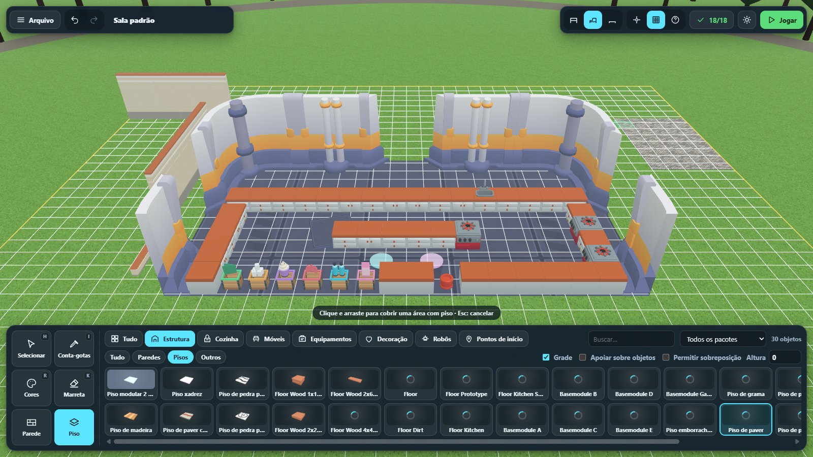

# Byte Bistro

[Português](README.md) · **English**


> 🚧 **Work in progress.** Features, levels and visuals are still changing.

### ▶️ [Play online: byte-bistro.pages.dev](https://byte-bistro.pages.dev)

Runs straight in the browser, nothing to install. Best on a computer with a keyboard, in an up-to-date Chrome or Edge.

---

## About

Byte Bistro is a cooperative 3D cooking game for **two players on the same screen**, in the style of *Overcooked*. The two cooks share one kitchen to prepare and serve the dishes that are ordered before time runs out: fetch ingredients, chop, cook, plate up and deliver.

The main level is a wedding reception whose guests are robots placing the orders. The game also has a **build mode**, inspired by *The Sims 4*, where anyone can build their own kitchen and surroundings and then play in them.

## Academic goal

The project was developed for the **Software Design and Architecture** course. The focus is not only the finished game but the **process of designing and evolving software**:

- turning a **concept** (a cooperative cooking game in the browser) into an architecture;
- building it **incrementally, part by part**: first the core game loop, then the full kitchen, the characters, the map editor, the 3D model pipeline and the scenery;
- splitting responsibilities into layers (core, scenes, game rules, systems, editor and interface), keeping the rules in code that does not depend on the graphics;
- treating content as **data**: levels and maps are JSON files, and each model pack describes itself in a `pack.json`, so new levels need no code changes.

## Set in São Bento do Sul

The game is set in **São Bento do Sul, Santa Catarina, Brazil**, as a way to showcase the city:

- the level picker is a miniature of the town, with the **Igreja Matriz** (main church), the square's bandstand and araucaria pines;
- the build-mode object packs were modelled from local references: the **Praça** (town square), the **Igreja Matriz** and the **Schlachtfest** festival, with half-timbered houses, stalls and bunting.


## How to play

1. In the menu, pick a level on the map, then the two cooks: Player 1 switches with `A`/`D` and Player 2 with the arrow keys.

   

2. Orders appear at the top of the screen, each showing the dish, its ingredients and the time left.
3. Take ingredients from the crates, **chop** them on the cutting board, **cook** them on the stove (pan or pot), **plate** them and **deliver** at the serving counter.
4. Dirty plates come back and must be **washed** at the sink. If something burns and catches fire, grab the **extinguisher**.
5. You can **throw** ingredients to your partner and work as a team. Fast, well-made dishes score more; expired orders cost points.

| Action | Player 1 | Player 2 |
| --- | --- | --- |
| Move | `W A S D` | Arrow keys |
| Run | Left `Shift` | `Numpad 0` |
| Pick up, drop, combine, deliver | `E` | `Enter` |
| Hold: chop, wash, extinguish · Tap with an ingredient: throw | `F` | Right `Shift` |
| Recipe book | `Tab` | — |
| Pause | `Esc` | — |

## Build mode

In the menu, **Criar mapa** opens the editor, inspired by *The Sims 4*'s build mode. A finished map can be played right away.


- A **catalogue** of more than 1,600 objects, grouped in tabs and packs, with search.
- **Draw walls and floors** by clicking and dragging.
- **Walls up, cutaway or down**, to see inside while building.
- Orbit camera, **top-down view**, grid, and a warning when an object does not fit.



- **Recolour each part of an object** without going back to Blender. Colours are saved with the map.


- Eyedropper, sledgehammer, copy and paste, undo and redo, and maps saved in the browser or exported as JSON.


## Technologies

| Technology | Used for |
| --- | --- |
| **TypeScript** | All of the game and editor code |
| **Babylon.js** | 3D engine in the browser (WebGL): scenes, cameras, lights, collision and animation |
| **Vite** | Development server and production bundling |
| **HTML and CSS** | Menus, game interface and editor |
| **Blender** | 3D modelling of the original packs (Casamento, Schlachtfest, Praça, Igreja Matriz), the São Bento do Sul map and the scenery around the levels |
| **glTF / GLB** | 3D model format loaded by the game |
| **Cloudflare Pages** | Hosting of the online version |

Free models (CC0) from the **KayKit** packs by Kay Lousberg and from **Kenney** were also used.

## Running locally

For evaluating the project:

```bash
npm install
npm run dev
```

Then open `http://127.0.0.1:5173`. To build the production version: `npm run build`.

## Status

Work in progress. Planned: new levels and recipes, storeys in build mode, sound, and balancing.

## Copyright

© 2026 Plusnar. **All rights reserved.** The code and original files in this repository are public for viewing and academic evaluation only. Copying, modifying, redistributing or reusing any part without the owner's written permission is prohibited. See [LICENSE](LICENSE).
