# Byte Bistro

[Português](README.md) · **English**

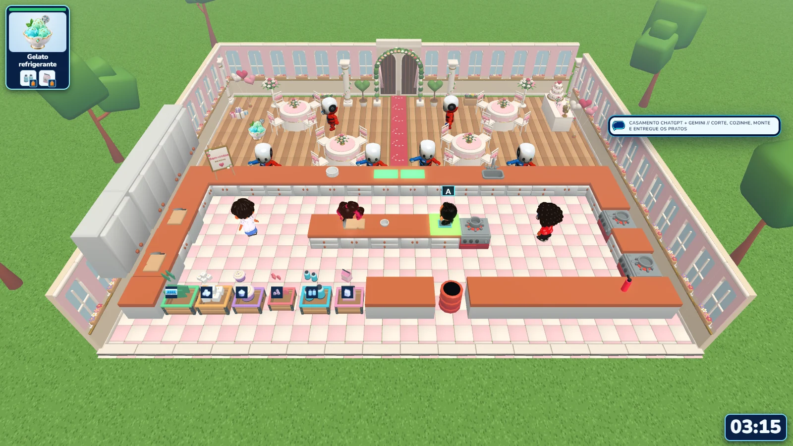

> 🚧 **Work in progress.** Features, levels and visuals are still changing.

### ▶️ [Play online: byte-bistro.pages.dev](https://byte-bistro.pages.dev)

Runs straight in the browser, nothing to install: the game on a PC or TV screen (up-to-date Chrome or Edge) and one phone per player as the controller.

---

## About

Byte Bistro is a cooperative 3D cooking game for **1 to 4 players on the same screen**, in the style of *Overcooked*. The cooks prepare and serve orders before time runs out.

The main level is a wedding reception whose guests are robots placing the orders. The game also has a **build mode**, inspired by *The Sims 4*, where anyone can build their own kitchen and surroundings and then play in them.

## Academic goal

The project was developed for the **Software Design and Architecture** course. The focus is not only the finished game but the **process of designing and evolving software**:

- turning a **concept** (a cooperative cooking game in the browser) into an architecture;
- building it **incrementally, part by part**: first the core game loop, then the full kitchen, the characters, the map editor, the 3D model pipeline, the scenery and phone controllers for up to 4 players;
- splitting responsibilities into layers (core, scenes, game rules, systems, editor and interface), keeping the rules in code that does not depend on the graphics;
- treating content as **data**: levels and maps are JSON files, and each model pack describes itself in a `pack.json`, so new levels need no code changes.

## Set in São Bento do Sul

The game is set in **São Bento do Sul, Santa Catarina, Brazil**, as a way to showcase the city:

- the level selector is a 3D globe featuring the **main church**, the **SGD** entrance, **Salão Pauli**, and the **Univille** campus. The Rainha 585 bus travels across the globe between araucaria trees;
- the build-mode object packs were modelled from local references: the **Praça** (town square), the **Igreja Matriz** and the **Schlachtfest** festival, with half-timbered houses, stalls and bunting.

## Game screenshots

### Loading and phone pairing

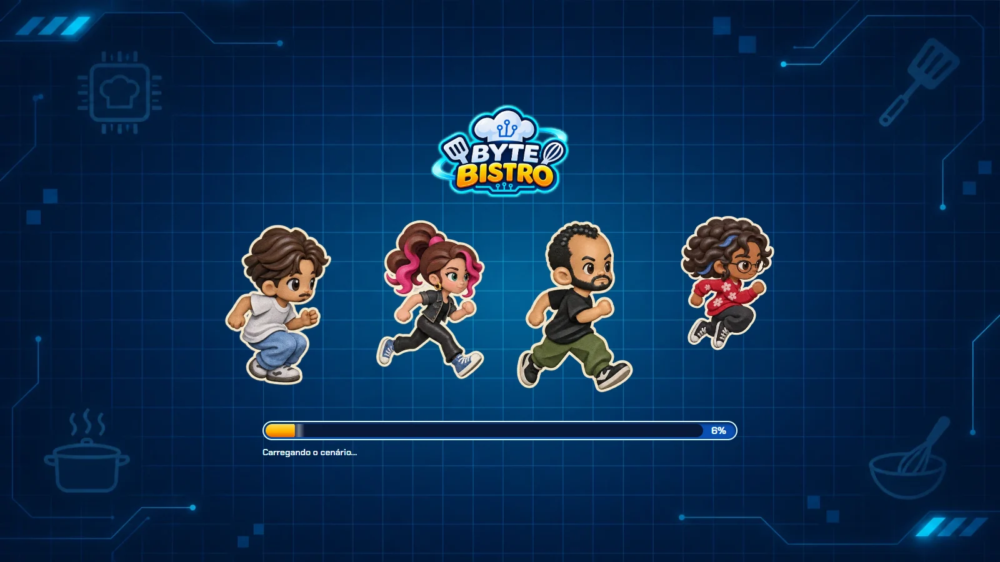

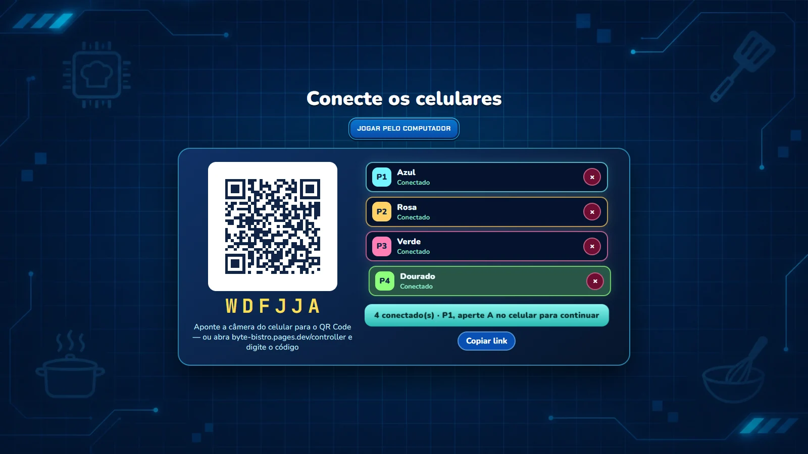

### Main menu and level selector

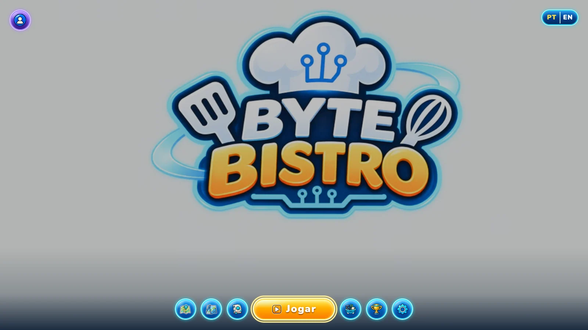

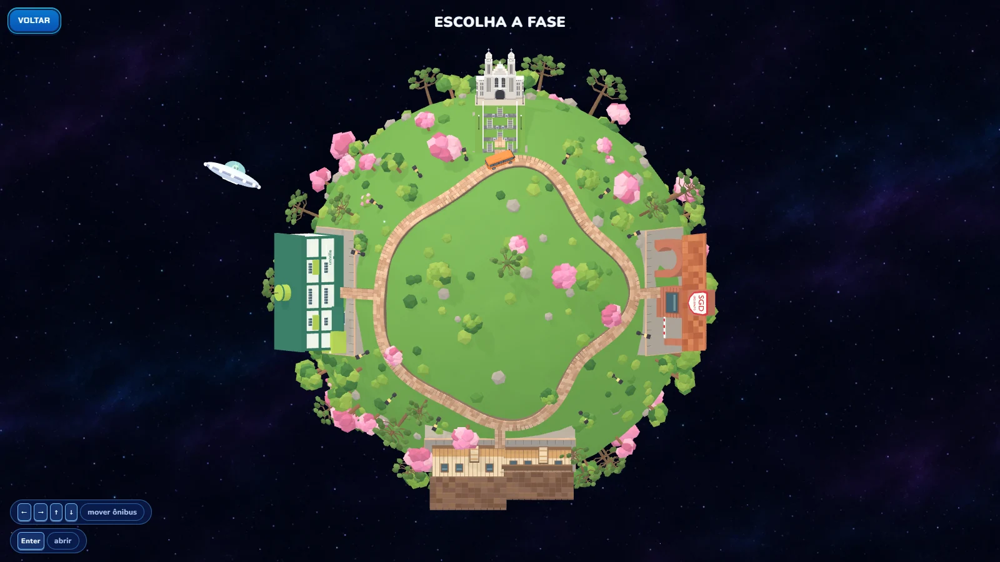

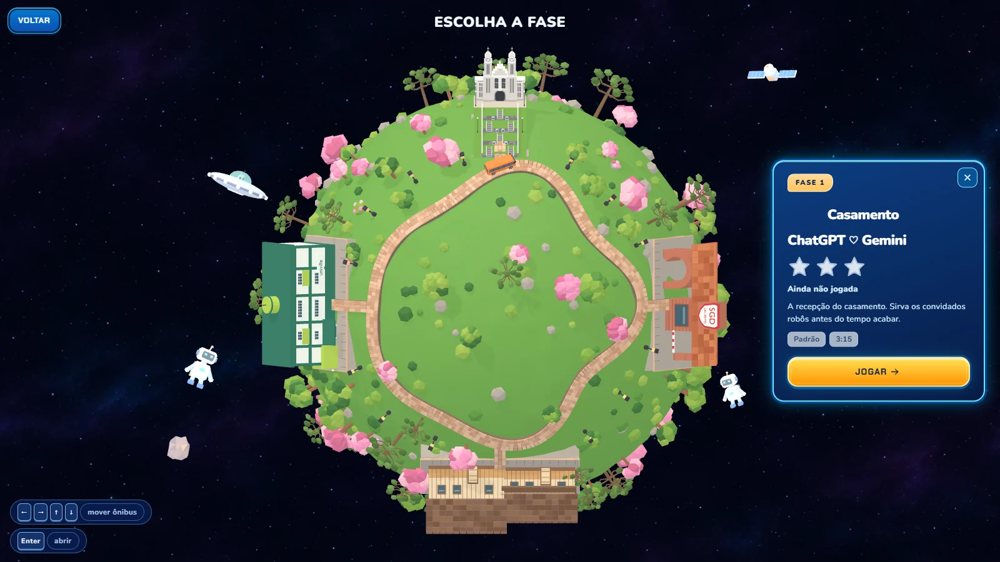

## How to play

**On a computer**, choose **Play on this computer** on the pairing screen to start a local single-player session. **With phones**, connect one to four players to the same room. Each person uses their own phone as a controller.

1. **Connect the phones.** Scan the QR code or open the [browser controller](https://byte-bistro.pages.dev/controller) and enter the six-character code. The first phone is P1. The next phones take slots P2, P3 and P4, each with its own colour.
2. **P1 presses A** once everyone has joined. The room locks and disconnected players can return to the same slot.
3. **P1 navigates the menus.** Use the arrows, **A** to confirm and **B** to go back. The level selector turns the globe to bring the chosen landmark to the top.
4. **Each player chooses a cook.** Use ← and → to switch, **A** to confirm and **B** to undo. When everyone is ready, P1 presses **A** to start the match.
5. **Prepare and serve the orders.** The queue shows dishes, ingredients and deadlines. Collect ingredients, use the prep stations, plate the dishes and serve them at the counter before time runs out.

The **PT | EN** button switches the game language.

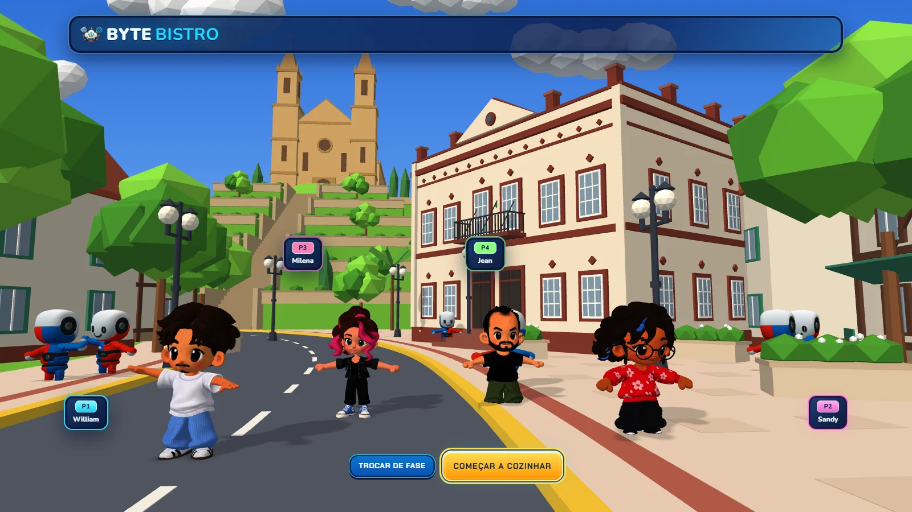

### Phone controller

Hold your phone sideways. The layout changes with the stage of the game.

| Player one's menu controller | Controller during a match |
| --- | --- |
| 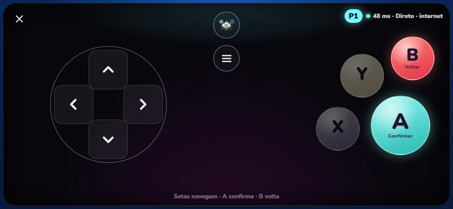 | 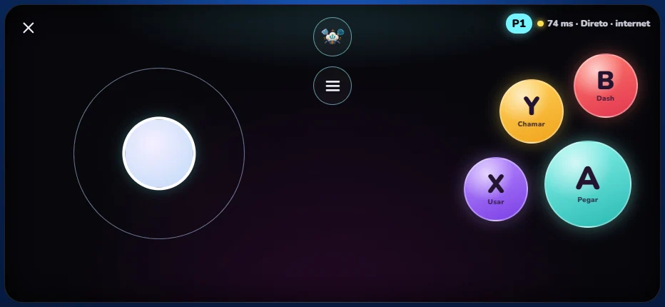 |

| Stage | Controls |
| --- | --- |
| Menus (P1) | Arrows to navigate, **A** to confirm and **B** to go back |
| Character selection | ← → to switch, **A** to confirm and **B** to undo |
| Match | Analogue stick to move and run. **A** picks up, drops or serves, **X** uses stations and tools, **B** dashes and **Y** calls teammates |
| Match shortcuts | Recipe book and pause on the centre buttons |

The ✕ in the corner opens phone options, including name, fullscreen, leaving the room and connection diagnostics.

### More players, same kitchen

- **1 to 4 cooks.** With one cook, the camera follows them. With two, it splits when they move apart. With three or four, one camera frames the whole group.
- Star goals scale with team size. A dash can knock over teammates, and kitchen events can affect every cook.
- Physical gamepads also work during a match.

### Keyboard

| Action | Key |
| --- | --- |
| Move | `W A S D` |
| Run | Left `Shift` |
| Dash | `Space` |
| Pick up, put down, combine or serve | `E` |
| Chop, wash, use the extinguisher, or aim and throw | Hold `F` |
| Recipe book | `Tab` |
| Pause | `Esc` |

### Recipes, pause and results

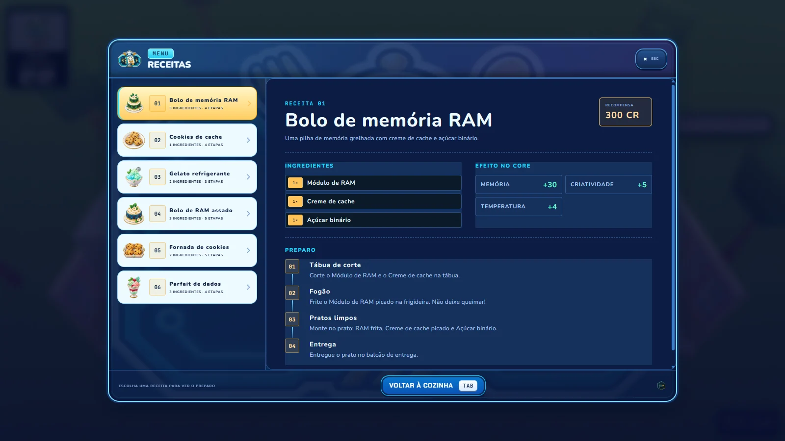

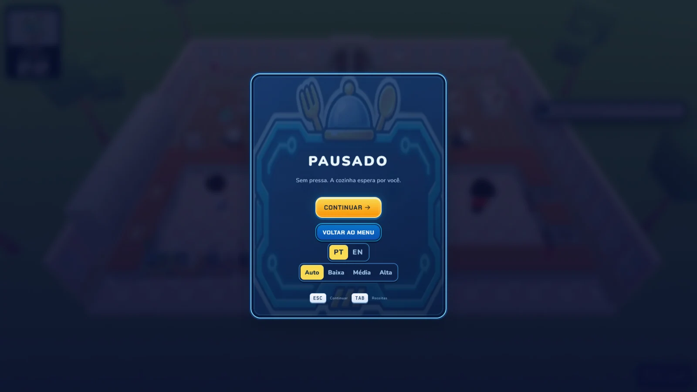

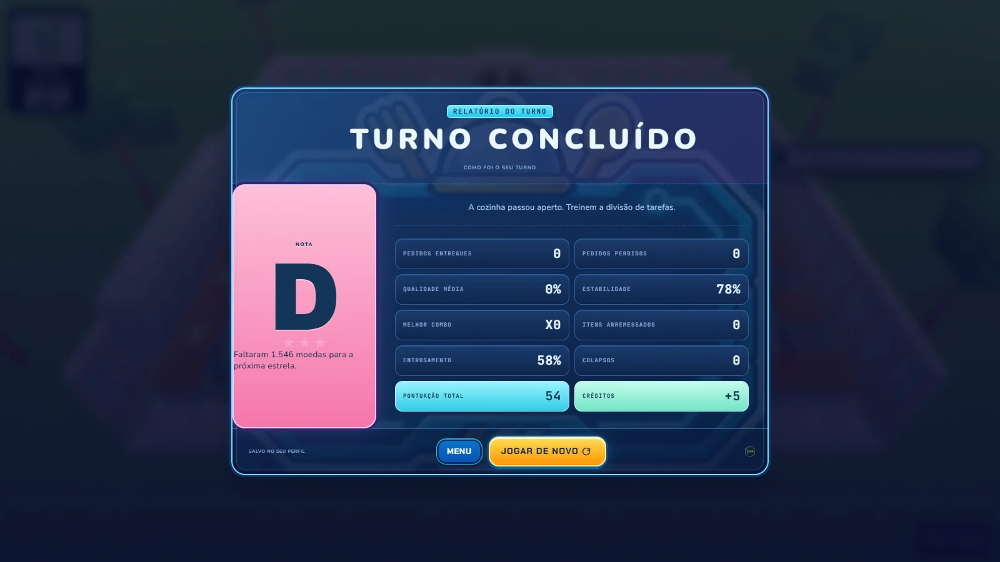

## Build mode

In the menu, **Create map** opens the editor, inspired by *The Sims 4*'s build mode. A finished map can be played right away.

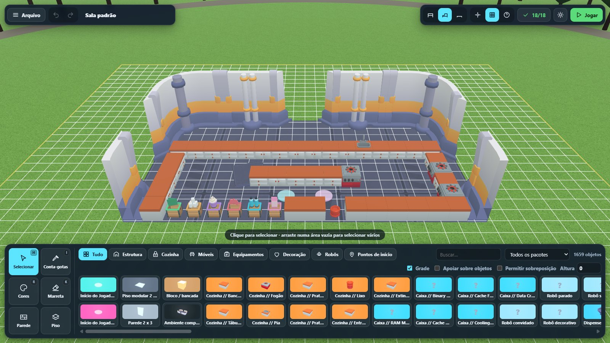

- A **catalogue** of more than 1,600 objects, grouped in tabs and packs, with search.
- **Draw walls and floors** by clicking and dragging.
- **Walls up, cutaway or down**, to see inside while building.
- Camera and controls as in *The Sims 4*: the right button rotates and tilts, dragging the ground (left or wheel button) moves the view, the wheel zooms towards the cursor and the mouse at the screen edge slides the camera. `W A S D` move, `Q`/`E` rotate, `,`/`.` rotate the object and `9`/`0` raise and lower it.
- **Free placement**: any object goes anywhere, off the lot too (it becomes scenery) and on top of other objects, like a lamp on a table.
- **Top-down view** and grid.


- **Recolour each part of an object** without going back to Blender. Colours are saved with the map.

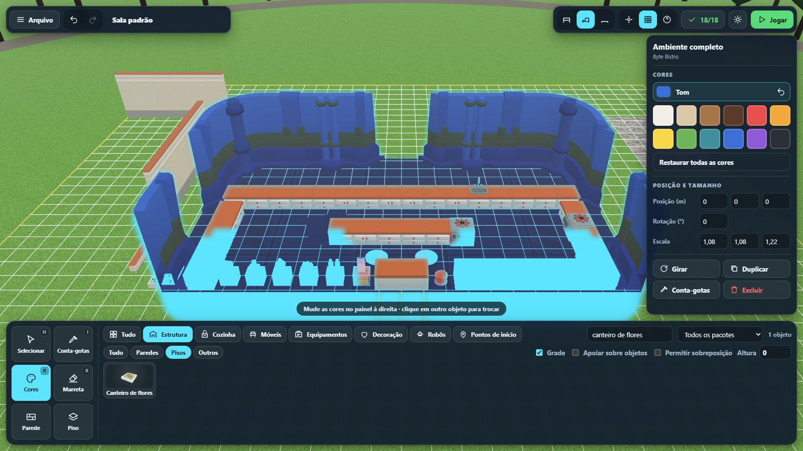

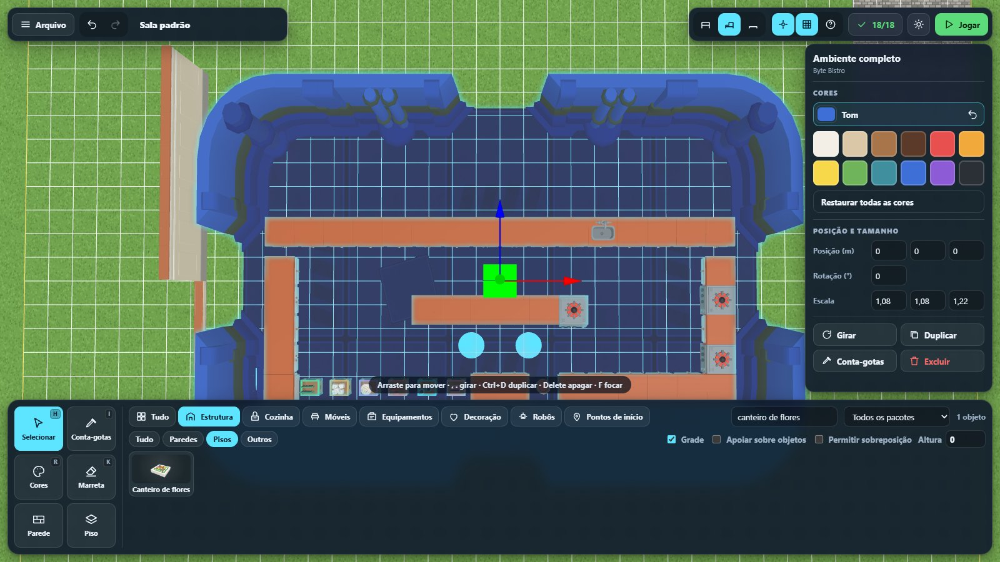

- Eyedropper, sledgehammer, copy and paste, undo and redo, and maps saved in the browser or exported as JSON.

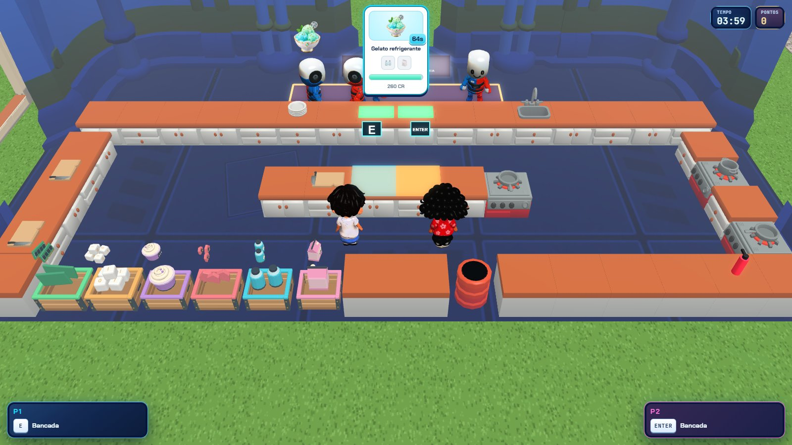

## Phone controller architecture

The TV/PC is the **host** and the game's only authority; phones only send commands (stick axis and buttons), never state. The room is a Cloudflare **Durable Object** that only introduces the two sides and, when needed, relays.

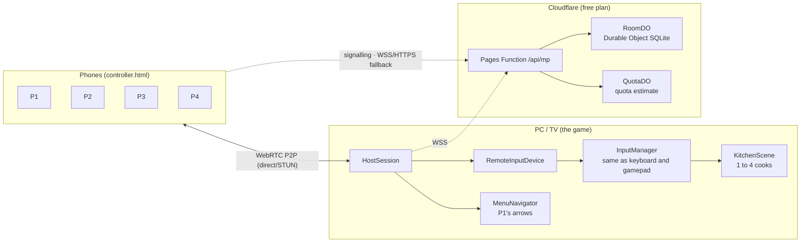

**Transport, picked by the phone on its own:**

1. **Direct WebRTC** (same Wi-Fi) and **WebRTC through STUN** (different networks), with two channels: `act` (reliable, ordered: buttons and messages) and `mv` (unordered, no retransmits: the stick, as 10-byte binary frames at an adaptive 10–60 Hz).
2. **WebSocket relay (WSS 443)** through the room, used from the first second while WebRTC negotiates and whenever it is not possible.
3. **Batched HTTPS** when even WebSockets are blocked.
4. Cloudflare **TURN** is optional and **off** by default (`STRICT_FREE_MODE`), because it can be billed.

**Main pieces:**

| Part | Files | Role |
| --- | --- | --- |
| Protocol | `src/net/mp/protocol.ts` | Messages, binary frame, validation (shared with the Worker) |
| Phone | `src/controller/`, `ControllerSession.ts` | Controller UI, transport choice, reconnection |
| Host | `HostSession.ts`, `PhoneHub.ts` | Room, WebRTC connections, pairing screen, each phone's layout |
| Input | `remoteInput.ts`, `core/InputManager.ts` | Smoothing, safety (lets go if a phone vanishes), same layer as the keyboard |
| Menus | `ui/MenuNavigator.ts`, `ui/spatialNav.ts` | Arrow navigation by the buttons' position on screen |
| Server | `workers/mp/` | `RoomDO` (rooms, tokens, relay, limits) and `QuotaDO` (daily quota) |

**Session mechanics:** the host decides each phone's layout (`game`, `menu`, `select` or `wait`); outside a match, buttons become menu commands and never reach a cook. If a phone stops sending, its cook stops and lets go. If the TV reloads the page, it takes the same room back for up to 2 minutes and the phones reconnect on their own.

**Security:** 256-bit tokens per session (stored only as SHA-256), sent in the WebSocket header and never in URLs; origin and per-message validation; per-IP and per-connection limits; only the host can kick, lock or close the room.

## Setup and deployment

The site lives on **Cloudflare Pages** and the rooms in a separate **Worker** (Pages cannot define Durable Objects). Everything fits the **Workers Free** plan: when a quota runs out Cloudflare refuses the operation instead of billing, and the game also stays under 60 % of each quota.

1. **Rooms Worker** (once, and after every change in `workers/mp/`):

   ```bash
   npx wrangler login
   npm run mp:deploy
   ```

   If the site runs on another domain, adjust `ALLOWED_ORIGINS` in `workers/mp/wrangler.toml`.

2. **Pages bindings:** Dashboard → Workers & Pages → project → Settings → Bindings → Add → Durable Object, in *Production* and *Preview*:
   - `ROOMS` → `RoomDO` of Worker `byte-bistro-mp`
   - `QUOTA` → `QuotaDO` of Worker `byte-bistro-mp`

3. **Site:** `npm run build` and publish `dist/` (through Git, or `npx wrangler pages deploy dist --project-name <project> --branch <production branch>`). The Function `functions/api/mp/[[path]].ts` serves `/api/mp/*` on the game's own origin.

4. **Check:** `https://<site>/api/mp/status` should answer with `"mode":"STRICT_FREE_MODE"`. `not-configured` means the bindings from step 2 are missing.

**TURN (optional, may be billed):** create a key under Realtime → TURN, store `TURN_KEY_ID` and `TURN_KEY_API_TOKEN` with `npx wrangler secret put … --config workers/mp/wrangler.toml`, and set `MP_MODE = "TURN_FREE_TIER"` and `TURN_ACK_NO_HARD_CAP = "yes"` in `wrangler.toml`.

## Technologies

| Technology | Used for |
| --- | --- |
| **TypeScript** | All of the game and editor code |
| **Babylon.js** | 3D engine in the browser (WebGL): scenes, cameras, lights, collision and animation |
| **Vite** | Development server and production bundling |
| **HTML and CSS** | Menus, game interface and editor |
| **Blender** | 3D modelling of the original packs (Casamento, Schlachtfest, Praça, Igreja Matriz), the São Bento do Sul map and the scenery around the levels |
| **glTF / GLB** | 3D model format loaded by the game |
| **Cloudflare Pages** | Hosting of the online version |
| **Cloudflare Workers + Durable Objects (SQLite)** | Phone rooms: signalling, WebSocket relay with Hibernation, limits and quota |
| **WebRTC (DataChannels)** | Direct, low-latency phone ↔ game link |

Free models (CC0) from the **KayKit** packs by Kay Lousberg and from **Kenney** were also used.

## Running locally

```bash
npm install
npm run mp:dev     # terminal 1: rooms Worker (port 8787)
npm run dev        # terminal 2: the game (http://127.0.0.1:5173)
```

To use a real phone on the same network, run `MP_LAN=1 npm run dev` and open `http://<pc-ip>:5173/controller#CODE` on the phone. Without phones, choose **Play on this computer** on the pairing screen.

Tests: `npm test` (unit), `npm run mp:test:integration` (server, with `mp:dev` running) and `npm run mp:test:e2e` (Chrome with 4 simulated phones, with `mp:dev` and `dev` running). Production build: `npm run build`.

## Status

Work in progress. Planned: new levels and recipes, storeys in build mode, sound, and balancing. The phone controller has been tested automatically (4 simulated phones in one browser); tests on real phones and mobile networks are under way.

## Copyright

© 2026 Plusnar. **All rights reserved.** The code and original files in this repository are public for viewing and academic evaluation only. Copying, modifying, redistributing or reusing any part without the owner's written permission is prohibited. See [LICENSE](LICENSE).
