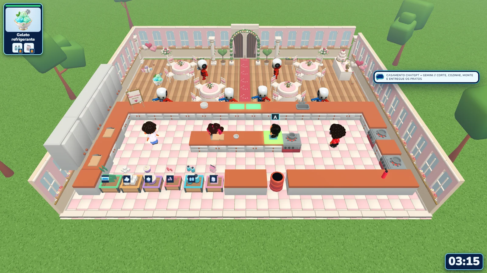
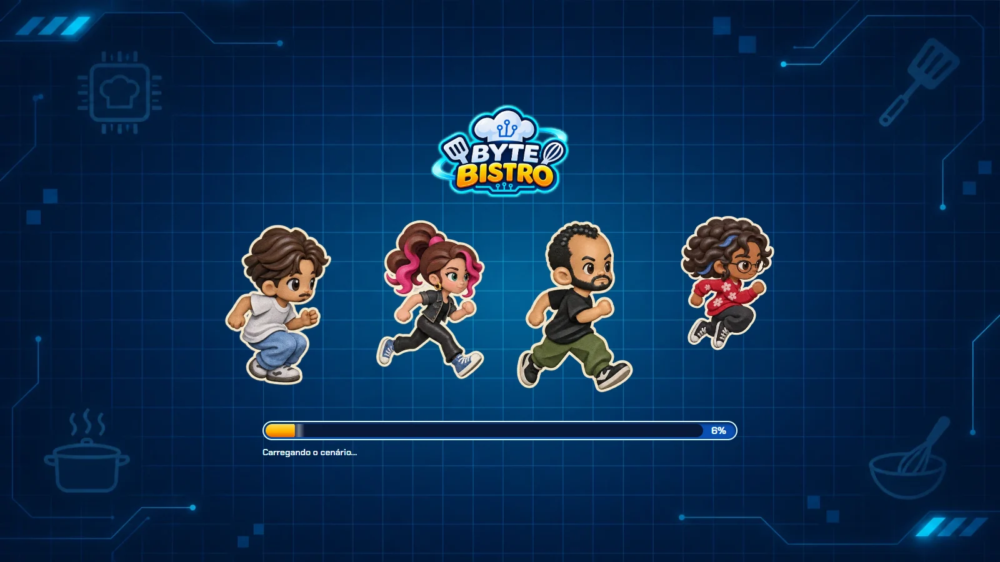
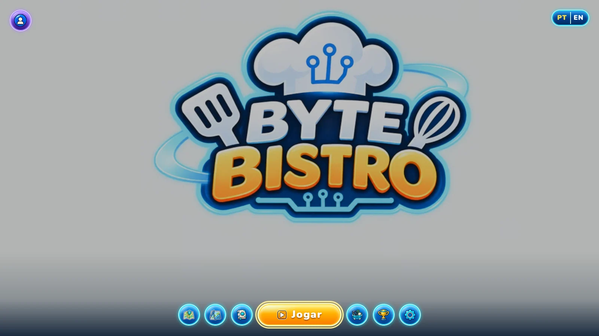
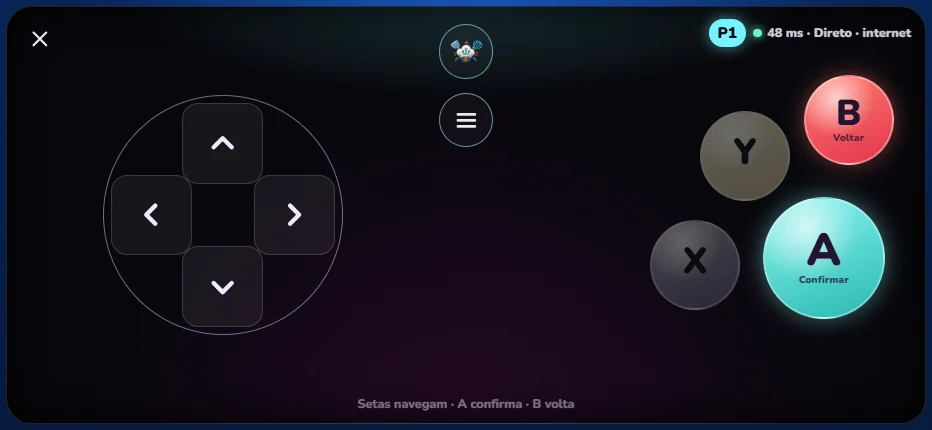
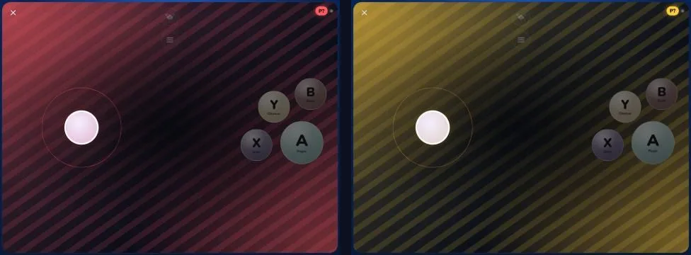
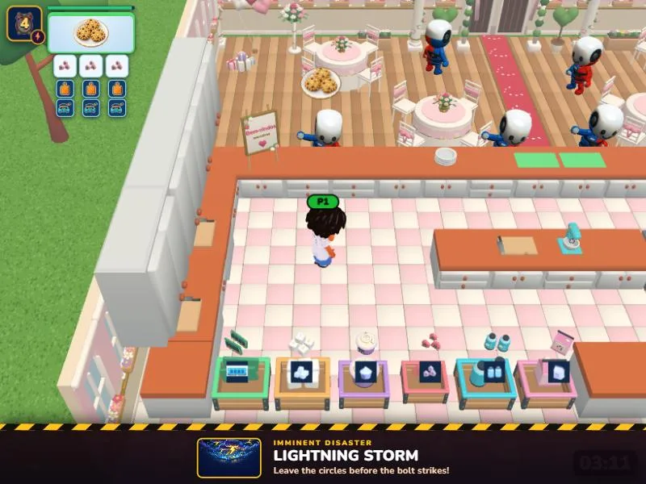
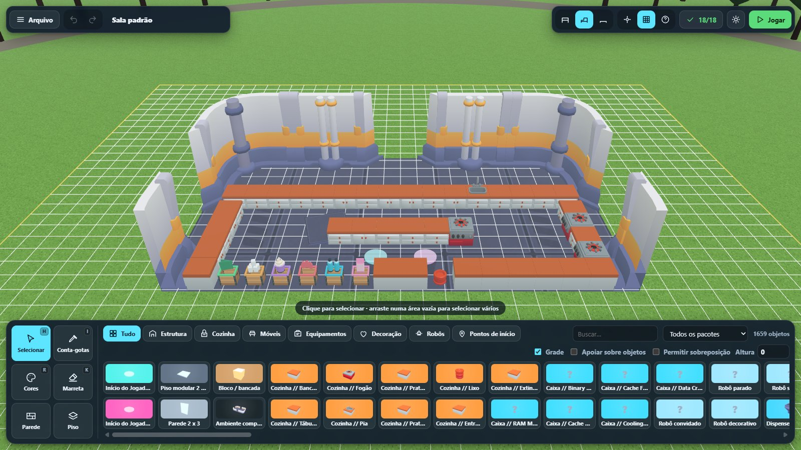
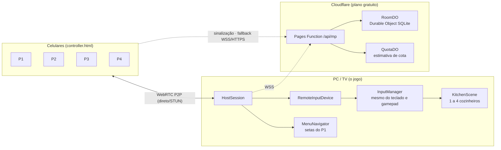

# Byte Bistro

**Português** · [English](README.en.md)



> 🚧 **Projeto em desenvolvimento.** Funcionalidades, fases e visual ainda estão mudando.

### ▶️ [Jogar online: byte-bistro.pages.dev](https://byte-bistro.pages.dev)

Jogue direto no navegador em um PC ou TV. Use um celular por pessoa no modo cooperativo ou escolha **Jogar pelo computador** para jogar sozinho com teclado.

---

## Sobre o projeto

Byte Bistro é um jogo 3D cooperativo de cozinha para **1 a 4 jogadores na mesma tela**, no estilo *Overcooked*. Os cozinheiros preparam e servem os pratos pedidos antes que o tempo acabe.

A fase principal é a recepção de um casamento, com convidados robôs que fazem os pedidos. O jogo também tem um **modo construção**, inspirado no do *The Sims 4*, em que qualquer pessoa monta a própria cozinha e o próprio cenário e depois joga nele.

## Objetivo acadêmico

O projeto foi desenvolvido para a disciplina de **Design e Arquitetura de Software**. O foco não é só o jogo pronto, mas o **processo de projetar e evoluir um software**:

- partir de um **conceito** (um jogo cooperativo de cozinha no navegador) e transformá-lo em uma arquitetura;
- desenvolver de forma **incremental, por partes**: primeiro o ciclo básico de jogo, depois a cozinha completa, os personagens, o editor de mapas, o pipeline de modelos 3D, o cenário e o controle por celular para até 4 jogadores;
- separar responsabilidades em camadas (núcleo, cenas, regras do jogo, sistemas, editor e interface), mantendo as regras em código independente da parte gráfica;
- tratar o conteúdo como **dados**: fases e mapas são arquivos JSON, e cada pacote de modelos se descreve em um `pack.json`. Assim, dá para criar fases sem mexer no código.

## Ambientado em São Bento do Sul

O jogo é ambientado em **São Bento do Sul (SC)** como forma de divulgar a cidade:

- o seletor de fases é um globo 3D com a **Igreja Matriz**, a entrada da **SGD**, o **Salão Pauli** e o campus da **Univille**. O ônibus Rainha 585 percorre o globo entre as araucárias;
- os pacotes de objetos do modo construção foram modelados a partir de referências locais: **Praça**, **Igreja Matriz** e a festa **Schlachtfest**, com suas casas em enxaimel, barracas e bandeirolas.

## Telas do jogo

### Carregamento e pareamento




### Menu inicial e seletor de fases




## Como jogar

Depois da introdução, clique em **Jogar** para abrir a tela de pareamento. **No computador**, escolha **Jogar pelo computador** para abrir o modo local de um jogador. **Para jogar com celulares**, use a mesma sala para conectar de um a quatro jogadores. Cada pessoa usa o próprio celular como controle.

1. **Conecte os celulares.** Leia o QR Code ou abra o [controle no navegador](https://byte-bistro.pages.dev/controller) e digite o código de seis caracteres. O primeiro celular é o P1. Os seguintes ficam nas vagas P2, P3 e P4. Cada jogador tem sua cor, na ordem em que entra: **verde** (P1), **azul** (P2), **vermelho** (P3) e **amarelo** (P4).
2. **O P1 aperta A** quando todos entrarem. A sala é trancada e quem cair pode se reconectar à mesma vaga.
3. **O P1 navega pelos menus.** Use as setas, **A** para confirmar e **B** para voltar. O seletor gira o globo para trazer o local escolhido ao topo.
4. **Cada pessoa escolhe um cozinheiro.** Use ← e → para trocar, **A** para confirmar e **B** para desfazer. Quando todos estiverem prontos, o P1 começa a partida com **A**.
5. **Prepare e entregue os pedidos.** A fila mostra pratos, ingredientes e prazos. Pegue ingredientes nas caixas, use as estações de preparo, monte os pratos e entregue no balcão antes que o tempo acabe.
6. **Cuidado com os pedidos perdidos.** Cada prato não entregue dispara um evento na cozinha (veja [Eventos da cozinha](#eventos-da-cozinha)).

O botão **PT | EN** troca o idioma do jogo.


### Controle no celular

Segure o celular deitado. O layout acompanha a etapa do jogo, e o fundo do controle usa a cor do jogador (o mesmo tema para todos, só muda a cor).

| Navegação dos menus pelo P1 | Controle durante a partida |
| --- | --- |
|  |  |

| Momento | Controles |
| --- | --- |
| Menus (P1) | Setas para navegar, **A** para confirmar e **B** para voltar |
| Seleção de personagem | ← → para trocar, **A** para confirmar e **B** para desfazer |
| Partida | Analógico para mover: o cozinheiro sempre corre na velocidade máxima, para qualquer lado que o dedo empurrar. **A** pega, larga ou entrega, **X** usa estações e ferramentas, **B** dá uma avançada e **Y** chama os colegas |
| Atalhos na partida | Livro de receitas e pausa nos botões centrais |

O ✕ no canto abre as opções do celular, incluindo nome, tela cheia, saída da sala e diagnóstico da conexão.



**Vibração:** no Android o celular vibra nos botões e quando um evento começa. O Safari do iPhone não tem API de vibração; no iOS 18 ou mais novo o controle usa o "tic" de um interruptor escondido (um tic por botão, três seguidos nos eventos). Em iPhones mais antigos fica só o retorno visual.

### Mais jogadores, mesma cozinha

- **1 a 4 cozinheiros.** Cada um leva uma etiqueta **P1–P4** na cor do jogador flutuando sobre a cabeça, para não confundir cozinheiros com a mesma roupa. Com um, a câmera segue o cozinheiro. Com dois, ela se divide quando eles se afastam. Com três ou quatro, uma câmera enquadra todo o grupo.
- As metas de estrelas acompanham o tamanho da equipe. A avançada pode derrubar os colegas, e os eventos da cozinha afetam todos os cozinheiros.
- Gamepads físicos também funcionam na partida.

### Teclado

| Ação | Tecla |
| --- | --- |
| Mover | `W A S D` |
| Correr | `Shift` esquerdo |
| Avançada | `Espaço` |
| Pegar, largar, combinar ou entregar | `E` |
| Cortar, lavar, usar o extintor ou mirar e arremessar | Segure `F` |
| Livro de receitas | `Tab` |
| Pausar | `Esc` |

### Fila de pedidos

Cada pedido mostra só ícones, sem fundo nem nome do prato: o prato, a barra de tempo e os ingredientes. Embaixo de cada ingrediente aparecem as estações por onde ele passa, na ordem (tábua, fogão, forno, batedeira). O passo atual pisca em âmbar e os já feitos ganham um ✓. A borda do prato mostra a cor de quem está fazendo o pedido, fica vermelha quando o tempo acaba e verde com o selo **Entregar** quando está pronto.

Os avisos da partida aparecem ao lado do relógio, embaixo à direita, em cartões escuros com texto claro e borda colorida por tipo.

### Receitas e estações

- **Casamento** é a fase inicial e pede só **Bolo de memória RAM** e **Cookies de cache**.
- Também existem **Pizza de RAM**, **Rosquinhas de cache**, **Gelato refrigerante** e **Parfait de dados**, prontas para as próximas fases.
- **Forno** e **batedeira** têm modelos próprios (feitos no Blender). A porta do forno abre ao colocar ou tirar a bandeja, que fica visível na grade; o batedor gira enquanto se mistura. Os cozinheiros têm poses próprias para bater na tigela e para alcançar dentro do forno. No editor de mapas, os dois são obrigatórios.

### Eventos da cozinha

Quando um prato não é entregue, a cozinha sofre um evento aleatório: controles invertidos, invasão alienígena, tempestade de raios, chuva de tomates, picape desgovernada, pia estourada ou invasão de ratos.

- Uma **faixa listrada de perigo** sobe um pouco na borda de baixo, de ponta a ponta, com a arte, o nome e a dica do evento, e desce depois do aviso.
- Quando o evento começa, **a tela treme**, os **celulares vibram** e uma **vinheta vermelha** aparece ao redor da tela; ela some em fade out no fim.
- Um **relógio pequeno** à esquerda dos pedidos conta o aviso e o tempo do evento, e some quando ele acaba.
- O selo de **caos** (incêndio) fica no canto superior direito, sem cobrir os pedidos.



### Receitas, pausa e resultados


## Modo construção

No menu, **Criar mapa** abre o editor, inspirado no modo construção do *The Sims 4*. O mapa pronto pode ser jogado na hora.



- **Catálogo** com mais de 1.600 objetos, separados por abas e por pacote, com busca.
- **Desenhar paredes e pisos** clicando e arrastando.
- **Paredes em pé, em corte ou abaixadas**, para enxergar o interior enquanto constrói.
- Câmera e controles como no *The Sims 4*: botão direito gira e inclina, arrastar o chão (botão esquerdo ou roda) move a vista, a roda aproxima em direção ao cursor e o mouse na borda da tela desliza a câmera. `W A S D` movem, `Q`/`E` giram, `,`/`.` giram o objeto e `9`/`0` sobem e descem.
- **Colocação livre**: qualquer objeto vai em qualquer lugar, inclusive fora do lote (vira cenário) e em cima de outros objetos, como uma luminária sobre a mesa.
- **Vista de cima** e grade.


- **Mudar a cor de cada parte de um objeto** sem precisar voltar ao Blender. As cores ficam salvas no mapa.


- Conta-gotas, marreta, copiar e colar, desfazer e refazer, e mapas salvos no navegador ou exportados em JSON.


## Arquitetura do controle por celular

A TV/PC é o **host** e a única autoridade do jogo; os celulares só enviam comandos (eixo do analógico e botões), nunca estado. A sala é um **Durable Object** da Cloudflare que só faz a apresentação inicial e, quando necessário, a retransmissão.



**Transporte, escolhido sozinho pelo celular:**

1. **WebRTC direto** (mesma rede Wi-Fi) e **WebRTC via STUN** (redes diferentes), com dois canais: `act` (confiável, ordenado: botões e mensagens) e `mv` (sem ordem nem reenvio: o analógico, em quadros binários de 10 bytes, 10–60 Hz adaptativos).
2. **Relay WebSocket (WSS 443)** pela sala, usado desde o primeiro segundo enquanto o WebRTC negocia e quando ele não é possível.
3. **HTTPS em lote** quando até o WebSocket está bloqueado.
4. **TURN** da Cloudflare é opcional e vem **desligado** (`STRICT_FREE_MODE`), porque pode gerar cobrança.

**Peças principais:**

| Parte | Arquivo | Papel |
| --- | --- | --- |
| Protocolo | `src/net/mp/protocol.ts` | Mensagens, quadro binário, validação (compartilhado com o Worker) |
| Celular | `src/controller/`, `ControllerSession.ts` | Interface do controle, escolha de transporte, reconexão |
| Host | `HostSession.ts`, `PhoneHub.ts` | Sala, conexões WebRTC, tela de pareamento, layout de cada celular |
| Entrada | `remoteInput.ts`, `core/InputManager.ts` | Suavização, segurança (solta tudo se o celular sumir), mesma camada do teclado |
| Menus | `ui/MenuNavigator.ts`, `ui/spatialNav.ts` | Navegação por setas pela posição dos botões na tela |
| Servidor | `workers/mp/` | `RoomDO` (salas, tokens, relay, limites) e `QuotaDO` (cota diária) |

**Mecânica de sessão:** o host decide o layout de cada celular (`game`, `menu`, `select` ou `wait`); fora da partida, os botões viram comandos de menu e não chegam ao cozinheiro. Se um celular para de enviar, o cozinheiro para e solta tudo. Se a TV recarregar a página, ela retoma a mesma sala por até 2 minutos e os celulares reconectam sozinhos.

**Segurança:** tokens de 256 bits por sessão (guardados só como SHA-256), enviados no cabeçalho do WebSocket e nunca na URL; validação de origem e de cada mensagem; limites por IP e por conexão; só o host expulsa, tranca ou encerra a sala.

## Contas de jogador

O botão de conta no menu permite criar uma conta com **usuário e senha** e guardar o progresso (estrelas, recordes, ranks, desbloqueios, nome e avatar) para continuar em outro aparelho. Sem conta, o progresso fica só no navegador, e ele pode ser importado para a conta depois.

- Tudo roda na Cloudflare: a Pages Function `functions/api/auth/[[path]].ts` atende `/api/auth/*` na mesma origem do jogo, com os dados no **D1** (`workers/accounts/`).
- As senhas são guardadas com PBKDF2-SHA256 e sal próprio. A sessão fica num cookie `HttpOnly`, `Secure` e `SameSite=Strict`, e no banco só o hash do token. Toda escrita confere a origem da página.
- Errar a senha várias vezes bloqueia a conta por alguns minutos.
- O salvamento usa número de revisão: dois aparelhos salvando ao mesmo tempo nunca apagam o progresso um do outro, porque o jogo mescla e tenta de novo.
- No perfil dá para trocar a senha (desconecta os outros aparelhos) e excluir a conta com todo o progresso.
- **Não há e-mail:** quem esquecer a senha não consegue recuperar a conta.

## Configurar e publicar

O site fica no **Cloudflare Pages** e as salas num **Worker** separado (o Pages não define Durable Objects). Tudo cabe no plano **Workers Free**: ao estourar uma cota, a Cloudflare recusa a operação em vez de cobrar, e o jogo ainda se limita a 60 % de cada cota.

1. **Worker das salas** (uma vez e a cada mudança em `workers/mp/`):

   ```bash
   npx wrangler login
   npm run mp:deploy
   ```

   Se o site tiver outro domínio, ajuste `ALLOWED_ORIGINS` em `workers/mp/wrangler.toml`.

2. **Bindings no Pages:** Dashboard → Workers & Pages → projeto → Settings → Bindings → Add → Durable Object, em *Production* e *Preview*:
   - `ROOMS` → `RoomDO` do Worker `byte-bistro-mp`
   - `QUOTA` → `QuotaDO` do Worker `byte-bistro-mp`

3. **Site:** `npm run build` e publique `dist/` (por Git ou `npx wrangler pages deploy dist --project-name <projeto> --branch <branch de produção>`). A Function `functions/api/mp/[[path]].ts` atende `/api/mp/*` na mesma origem do jogo.

4. **Conferir:** `https://<site>/api/mp/status` deve responder com `"mode":"STRICT_FREE_MODE"`. Se aparecer `not-configured`, faltam os bindings do passo 2.

5. **Contas (D1):**

   ```bash
   npx wrangler d1 create byte-bistro-accounts   # copie o database_id para workers/accounts/wrangler.toml
   npm run accounts:migrate                       # cria as tabelas no banco remoto
   ```

   No Pages: Settings → Bindings → Add → **D1 database**, em *Production* e *Preview*: `ACCOUNTS` → `byte-bistro-accounts`. Sem esse binding, `/api/auth/me` responde `not-configured` e o jogo segue só com o progresso local.

**TURN (opcional, pode cobrar):** crie uma chave em Realtime → TURN, grave `TURN_KEY_ID` e `TURN_KEY_API_TOKEN` com `npx wrangler secret put … --config workers/mp/wrangler.toml` e, em `wrangler.toml`, defina `MP_MODE = "TURN_FREE_TIER"` e `TURN_ACK_NO_HARD_CAP = "yes"`.

## Tecnologias

| Tecnologia | Para quê |
| --- | --- |
| **TypeScript** | Todo o código do jogo e do editor |
| **Babylon.js** | Motor 3D no navegador (WebGL): cenas, câmeras, luzes, colisão e animações |
| **Vite** | Servidor de desenvolvimento e empacotamento para publicar |
| **HTML e CSS** | Menus, interface do jogo e do editor |
| **Blender** | Modelagem 3D dos pacotes próprios (Casamento, Schlachtfest, Praça, Igreja Matriz), do mapa de São Bento do Sul, do cenário em volta das fases, do forno, da batedeira e dos pratos |
| **ChatGPT (via Codex CLI)** | Geração das ilustrações dos pratos novos, de ícones do HUD e das artes dos eventos |
| **glTF / GLB** | Formato dos modelos 3D usado pelo jogo |
| **Cloudflare Pages** | Hospedagem da versão online |
| **Cloudflare Workers + Durable Objects (SQLite)** | Salas dos celulares: sinalização, relay WebSocket com Hibernation, limites e cota |
| **WebRTC (DataChannels)** | Ligação direta celular ↔ jogo, com baixa latência |
| **Cloudflare D1** | Contas de jogador (usuário e senha), sessões e progresso salvo |

Também foram usados modelos gratuitos (licença CC0) dos pacotes **KayKit**, de Kay Lousberg, e **Kenney**.

## Executar localmente

```bash
npm install
npm run mp:dev        # terminal 1: Worker das salas (porta 8787)
npm run accounts:dev  # terminal 2: contas com D1 local (porta 8789)
npm run dev           # terminal 3: o jogo (http://127.0.0.1:5173)
```

Para usar um celular de verdade na mesma rede, rode `MP_LAN=1 npm run dev` e abra no celular `http://<ip-do-pc>:5173/controller#CÓDIGO`. Sem celular, use **Jogar pelo computador** na tela de pareamento.

Testes: `npm test` (unitários), `npm run mp:test:integration` (servidor, com `mp:dev` no ar) e `npm run mp:test:e2e` (Chrome com 4 celulares simulados, com `mp:dev` e `dev` no ar). Para a versão de publicação: `npm run build`.

## Status

Em desenvolvimento. O modo gráfico **Automático** ajusta a qualidade sem piscar a tela e não desce de nível à toa quando o navegador limita o jogo a 30 fps. Estão previstos novas fases e receitas, andares no modo construção, som e ajustes de equilíbrio. O controle por celular foi testado de forma automatizada (4 celulares simulados num navegador); testes em celulares e redes móveis reais estão em andamento.

## Direitos autorais

© 2026 Plusnar. **Todos os direitos reservados.** O código e os arquivos próprios deste repositório estão públicos apenas para consulta e avaliação acadêmica. É proibido copiar, modificar, redistribuir ou reutilizar qualquer parte sem autorização por escrito do proprietário. Veja [LICENSE](LICENSE).
