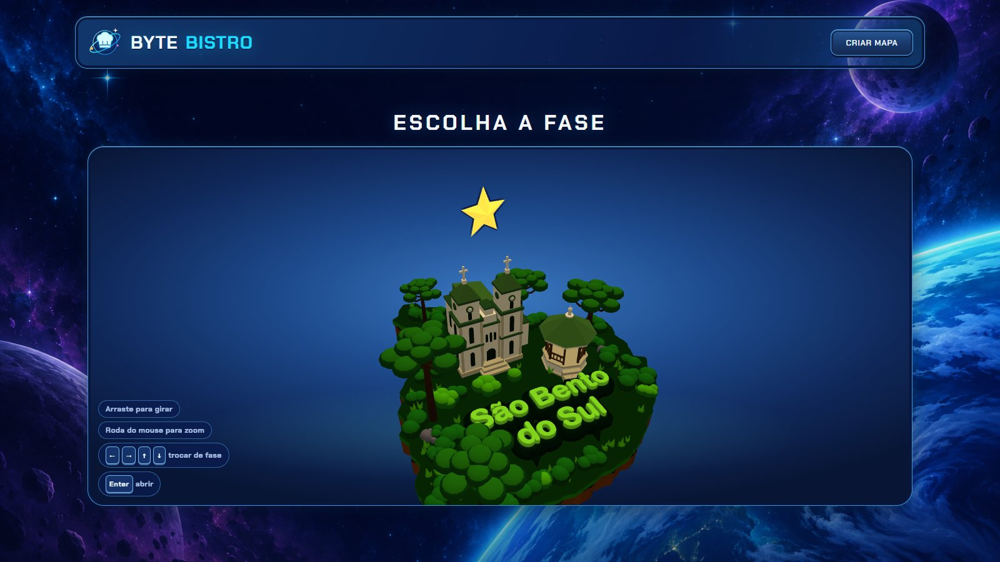
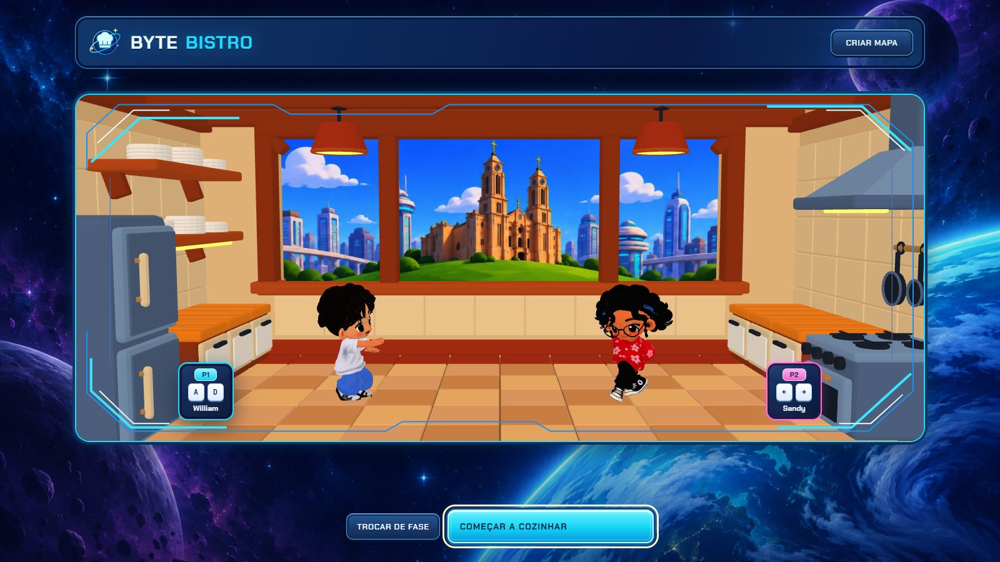
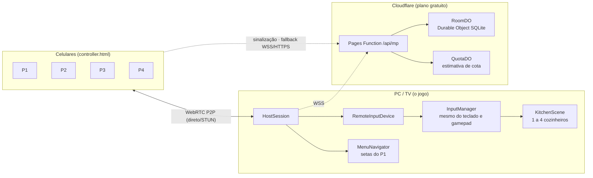

# Byte Bistro

**Português** · [English](README.en.md)


> 🚧 **Projeto em desenvolvimento.** Funcionalidades, fases e visual ainda estão mudando.

### ▶️ [Jogar online: byte-bistro.pages.dev](https://byte-bistro.pages.dev)

Roda direto no navegador, sem instalar nada: o jogo na tela do PC ou TV (Chrome ou Edge atualizado) e um celular por jogador como controle.

---

## Sobre o projeto

Byte Bistro é um jogo 3D cooperativo de cozinha para **1 a 4 jogadores na mesma tela**, no estilo *Overcooked*, em que **cada jogador usa o próprio celular como controle**. Os cozinheiros dividem a cozinha para preparar e servir os pratos pedidos antes que o tempo acabe: pegar ingredientes, cortar, cozinhar, montar o prato e entregar.

A fase principal é a recepção de um casamento, com convidados robôs que fazem os pedidos. O jogo também tem um **modo construção**, inspirado no do *The Sims 4*, em que qualquer pessoa monta a própria cozinha e o próprio cenário e depois joga nele.

## Objetivo acadêmico

O projeto foi desenvolvido para a disciplina de **Design e Arquitetura de Software**. O foco não é só o jogo pronto, mas o **processo de projetar e evoluir um software**:

- partir de um **conceito** (um jogo cooperativo de cozinha no navegador) e transformá-lo em uma arquitetura;
- desenvolver de forma **incremental, por partes**: primeiro o ciclo básico de jogo, depois a cozinha completa, os personagens, o editor de mapas, o pipeline de modelos 3D, o cenário e o controle por celular para até 4 jogadores;
- separar responsabilidades em camadas (núcleo, cenas, regras do jogo, sistemas, editor e interface), mantendo as regras em código independente da parte gráfica;
- tratar o conteúdo como **dados**: fases e mapas são arquivos JSON, e cada pacote de modelos se descreve em um `pack.json`. Assim, dá para criar fases sem mexer no código.

## Ambientado em São Bento do Sul

O jogo é ambientado em **São Bento do Sul (SC)** como forma de divulgar a cidade:

- o mapa de escolha de fases é uma miniatura da cidade, com a **Igreja Matriz**, o coreto da praça e as araucárias;
- os pacotes de objetos do modo construção foram modelados a partir de referências locais: **Praça**, **Igreja Matriz** e a festa **Schlachtfest**, com suas casas em enxaimel, barracas e bandeirolas.



## Como jogar

O jogo roda na tela grande (PC ou TV) e **cada jogador usa o próprio celular como controle**, no estilo dos jogos da Netflix: de **1 a 4 pessoas**, sem instalar nada.

1. **Conecte os celulares.** Ao abrir o jogo aparece um QR Code e um código de 6 letras. Cada jogador aponta a câmera para o QR (ou abre `byte-bistro.pages.dev/controller` e digita o código). O **primeiro celular é o P1**; os outros entram como P2, P3 e P4, cada um com sua cor.
2. **O P1 aperta A** quando todos tiverem entrado: quem está conectado nesse momento joga. A sala é trancada (quem cair reconecta sozinho na mesma vaga).
3. **O P1 comanda os menus** com as setas do celular (**A** confirma, **B** volta): menu inicial, mapa de fases, pausa, receitas e resultados. Os outros celulares mostram “P1 está no controle”.
4. **Cada um escolhe o seu cozinheiro** no próprio celular: ← → troca, **A** confirma (aparece um ✓) e **B** desfaz. Com todos prontos, o A do P1 começa a partida.
5. **Na cozinha**, os pedidos aparecem no topo, com prato, ingredientes e tempo. Pegue os ingredientes nas caixas, **corte** na tábua, **cozinhe** no fogão (frigideira ou panela), **monte** no prato e **entregue** no balcão. Pratos sujos voltam e precisam ser **lavados**; se algo pegar fogo, use o **extintor**. Dá para **arremessar** ingredientes para os colegas. Pedidos rápidos e bem feitos dão mais pontos; pedidos que expiram tiram pontos.

O botão **Jogadores** no menu volta ao QR Code para alguém entrar ou sair. O botão **PT | EN** troca o idioma do jogo inteiro na hora.



### O controle no celular

Segure o celular deitado, como um controle de console. O jogo decide o que cada celular mostra:

| Momento | Polegar esquerdo | Polegar direito | Centro |
| --- | --- | --- | --- |
| Menus (só o P1) | Setas (segurar repete) | **A** confirma · **B** volta | Receitas · Pausa (≡) |
| Seleção de personagem (todos) | ← → troca o cozinheiro | **A** confirma · **B** desfaz | — |
| Partida (todos) | Analógico 360° (no fim do curso o cozinheiro corre) | **A** pegar/largar/entregar · **X** usar (cortar, lavar, extintor, mirar) · **B** avançada (dash) · **Y** chamar | Receitas · Pausa (≡) |

O ✕ no canto abre as opções do celular: nome, tela cheia, sair da sala e diagnóstico da conexão.

### Mais jogadores, mesma cozinha

- **1 a 4 cozinheiros:** com 1, a câmera segue o cozinheiro; com 2, ela se divide quando os dois se afastam; com 3 ou 4, uma câmera só enquadra todos e se afasta conforme eles se espalham.
- **Metas de estrelas** acompanham o número de jogadores: metade com 1 cozinheiro, as mesmas de sempre com 2 e um pouco mais altas com 3 e 4 (mais mãos rendem cada vez menos, porque o fogão e a pia são os mesmos).
- A **avançada** derruba qualquer colega no caminho, e os **desastres** (tempestade, abdução, enchente…) atingem todos os cozinheiros em jogo.
- Gamepads físicos também funcionam na partida (o 1º no Jogador 1, e assim por diante).

### Teclado (desenvolvimento)

Para testar sem celular, abra o jogo com `?dev` no endereço e clique em **Continuar com o teclado** na tela do QR (2 jogadores):

| Ação | Jogador 1 | Jogador 2 |
| --- | --- | --- |
| Mover | `W A S D` | Setas |
| Correr | `Shift` esquerdo | `Numpad 0` |
| Avançada | `Espaço` | `Numpad .` |
| Chamar o colega | `Q` | `Numpad 1` |
| Pegar, largar, combinar, entregar | `E` | `Enter` |
| Segurar: cortar, lavar, extintor · Com ingrediente: mirar e arremessar | `F` | `Shift` direito |
| Livro de receitas | `Tab` | — |
| Pausar | `Esc` | — |

## Modo construção

No menu, **Criar mapa** abre o editor, inspirado no modo construção do *The Sims 4*. O mapa pronto pode ser jogado na hora.


- **Catálogo** com mais de 1.600 objetos, separados por abas e por pacote, com busca.
- **Desenhar paredes e pisos** clicando e arrastando.
- **Paredes em pé, em corte ou abaixadas**, para enxergar o interior enquanto constrói.
- Câmera e controles como no *The Sims 4*: botão direito gira e inclina, arrastar o chão (botão esquerdo ou roda) move a vista, a roda aproxima em direção ao cursor e o mouse na borda da tela desliza a câmera. `W A S D` movem, `Q`/`E` giram, `,`/`.` giram o objeto e `9`/`0` sobem e descem.
- **Colocação livre**: qualquer objeto vai em qualquer lugar, inclusive fora do lote (vira cenário) e em cima de outros objetos, como uma luminária sobre a mesa.
- **Vista de cima** e grade.


- **Mudar a cor de cada parte de um objeto** sem precisar voltar ao Blender. As cores ficam salvas no mapa.


- Conta-gotas, marreta, copiar e colar, desfazer e refazer, e mapas salvos no navegador ou exportados em JSON.


## Arquitetura do controle por celular

A TV/PC é o **host** e a única autoridade do jogo; os celulares só enviam comandos (eixo do analógico e botões), nunca estado. A sala é um **Durable Object** da Cloudflare que só faz a apresentação inicial e, quando necessário, a retransmissão.



**Transporte, escolhido sozinho pelo celular:**

1. **WebRTC direto** (mesma rede Wi-Fi) e **WebRTC via STUN** (redes diferentes), com dois canais: `act` (confiável, ordenado: botões e mensagens) e `mv` (sem ordem nem reenvio: o analógico, em quadros binários de 10 bytes, 10–60 Hz adaptativos).
2. **Relay WebSocket (WSS 443)** pela sala, usado desde o primeiro segundo enquanto o WebRTC negocia e quando ele não é possível.
3. **HTTPS em lote** quando até o WebSocket está bloqueado.
4. **TURN** da Cloudflare é opcional e vem **desligado** (`STRICT_FREE_MODE`), porque pode gerar cobrança.

**Peças principais:**

| Parte | Arquivo | Papel |
| --- | --- | --- |
| Protocolo | `src/net/mp/protocol.ts` | Mensagens, quadro binário, validação (compartilhado com o Worker) |
| Celular | `src/controller/`, `ControllerSession.ts` | Interface do controle, escolha de transporte, reconexão |
| Host | `HostSession.ts`, `PhoneHub.ts` | Sala, conexões WebRTC, tela de pareamento, layout de cada celular |
| Entrada | `remoteInput.ts`, `core/InputManager.ts` | Suavização, segurança (solta tudo se o celular sumir), mesma camada do teclado |
| Menus | `ui/MenuNavigator.ts`, `ui/spatialNav.ts` | Navegação por setas pela posição dos botões na tela |
| Servidor | `workers/mp/` | `RoomDO` (salas, tokens, relay, limites) e `QuotaDO` (cota diária) |

**Mecânica de sessão:** o host decide o layout de cada celular (`game`, `menu`, `select` ou `wait`); fora da partida, os botões viram comandos de menu e não chegam ao cozinheiro. Se um celular para de enviar, o cozinheiro para e solta tudo. Se a TV recarregar a página, ela retoma a mesma sala por até 2 minutos e os celulares reconectam sozinhos.

**Segurança:** tokens de 256 bits por sessão (guardados só como SHA-256), enviados no cabeçalho do WebSocket e nunca na URL; validação de origem e de cada mensagem; limites por IP e por conexão; só o host expulsa, tranca ou encerra a sala.

## Configurar e publicar

O site fica no **Cloudflare Pages** e as salas num **Worker** separado (o Pages não define Durable Objects). Tudo cabe no plano **Workers Free**: ao estourar uma cota, a Cloudflare recusa a operação em vez de cobrar, e o jogo ainda se limita a 60 % de cada cota.

1. **Worker das salas** (uma vez e a cada mudança em `workers/mp/`):

   ```bash
   npx wrangler login
   npm run mp:deploy
   ```

   Se o site tiver outro domínio, ajuste `ALLOWED_ORIGINS` em `workers/mp/wrangler.toml`.

2. **Bindings no Pages:** Dashboard → Workers & Pages → projeto → Settings → Bindings → Add → Durable Object, em *Production* e *Preview*:
   - `ROOMS` → `RoomDO` do Worker `byte-bistro-mp`
   - `QUOTA` → `QuotaDO` do Worker `byte-bistro-mp`

3. **Site:** `npm run build` e publique `dist/` (por Git ou `npx wrangler pages deploy dist --project-name <projeto> --branch <branch de produção>`). A Function `functions/api/mp/[[path]].ts` atende `/api/mp/*` na mesma origem do jogo.

4. **Conferir:** `https://<site>/api/mp/status` deve responder com `"mode":"STRICT_FREE_MODE"`. Se aparecer `not-configured`, faltam os bindings do passo 2.

**TURN (opcional, pode cobrar):** crie uma chave em Realtime → TURN, grave `TURN_KEY_ID` e `TURN_KEY_API_TOKEN` com `npx wrangler secret put … --config workers/mp/wrangler.toml` e, em `wrangler.toml`, defina `MP_MODE = "TURN_FREE_TIER"` e `TURN_ACK_NO_HARD_CAP = "yes"`.

## Tecnologias

| Tecnologia | Para quê |
| --- | --- |
| **TypeScript** | Todo o código do jogo e do editor |
| **Babylon.js** | Motor 3D no navegador (WebGL): cenas, câmeras, luzes, colisão e animações |
| **Vite** | Servidor de desenvolvimento e empacotamento para publicar |
| **HTML e CSS** | Menus, interface do jogo e do editor |
| **Blender** | Modelagem 3D dos pacotes próprios (Casamento, Schlachtfest, Praça, Igreja Matriz), do mapa de São Bento do Sul e do cenário em volta das fases |
| **glTF / GLB** | Formato dos modelos 3D usado pelo jogo |
| **Cloudflare Pages** | Hospedagem da versão online |
| **Cloudflare Workers + Durable Objects (SQLite)** | Salas dos celulares: sinalização, relay WebSocket com Hibernation, limites e cota |
| **WebRTC (DataChannels)** | Ligação direta celular ↔ jogo, com baixa latência |

Também foram usados modelos gratuitos (licença CC0) dos pacotes **KayKit**, de Kay Lousberg, e **Kenney**.

## Executar localmente

```bash
npm install
npm run mp:dev     # terminal 1: Worker das salas (porta 8787)
npm run dev        # terminal 2: o jogo (http://127.0.0.1:5173)
```

Para usar um celular de verdade na mesma rede, rode `MP_LAN=1 npm run dev` e abra no celular `http://<ip-do-pc>:5173/controller#CÓDIGO`. Sem celular, use `?dev` e **Continuar com o teclado**.

Testes: `npm test` (unitários), `npm run mp:test:integration` (servidor, com `mp:dev` no ar) e `npm run mp:test:e2e` (Chrome com 4 celulares simulados, com `mp:dev` e `dev` no ar). Para a versão de publicação: `npm run build`.

## Status

Em desenvolvimento. Estão previstos novas fases e receitas, andares no modo construção, som e ajustes de equilíbrio. O controle por celular foi testado de forma automatizada (4 celulares simulados num navegador); testes em celulares e redes móveis reais estão em andamento.

## Direitos autorais

© 2026 Plusnar. **Todos os direitos reservados.** O código e os arquivos próprios deste repositório estão públicos apenas para consulta e avaliação acadêmica. É proibido copiar, modificar, redistribuir ou reutilizar qualquer parte sem autorização por escrito do proprietário. Veja [LICENSE](LICENSE).
