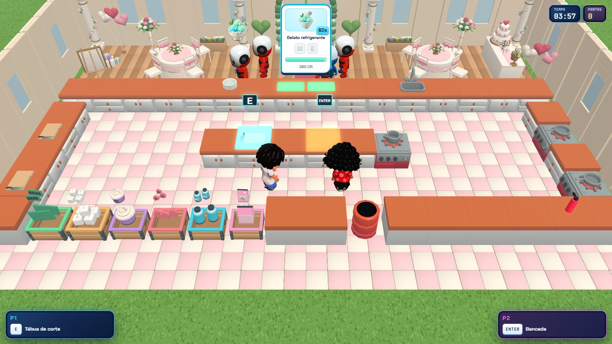
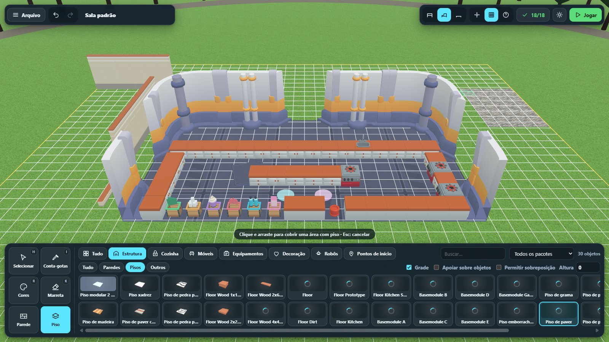
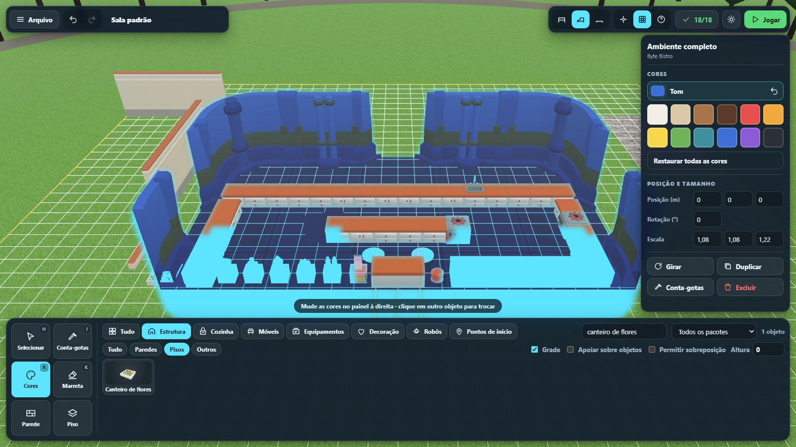
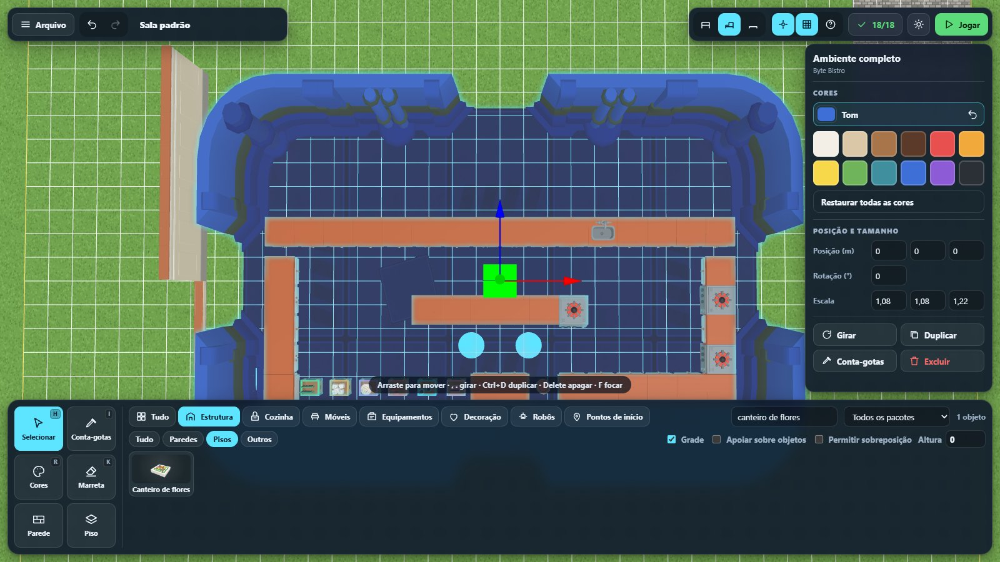
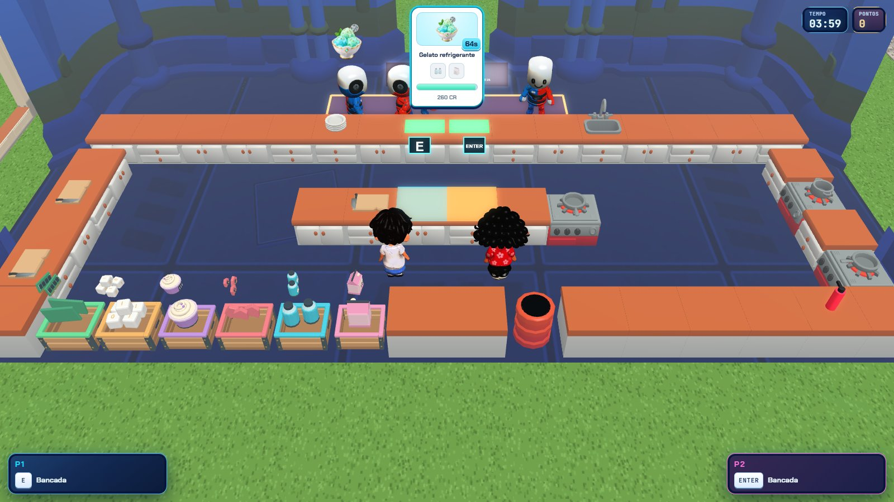

# Byte Bistro

**Português** · [English](README.en.md)



> 🚧 **Projeto em desenvolvimento.** Funcionalidades, fases e visual ainda estão mudando.

### ▶️ [Jogar online: byte-bistro.pages.dev](https://byte-bistro.pages.dev)

Roda direto no navegador, sem instalar nada. Recomendado: computador com teclado, Chrome ou Edge atualizado.

---

## Sobre o projeto

Byte Bistro é um jogo 3D cooperativo de cozinha para **dois jogadores na mesma tela**, no estilo *Overcooked*. Os dois cozinheiros dividem a cozinha para preparar e servir os pratos pedidos antes que o tempo acabe: pegar ingredientes, cortar, cozinhar, montar o prato e entregar.

A fase principal é a recepção de um casamento, com convidados robôs que fazem os pedidos. O jogo também tem um **modo construção**, inspirado no do *The Sims 4*, em que qualquer pessoa monta a própria cozinha e o próprio cenário e depois joga nele.

## Objetivo acadêmico

O projeto foi desenvolvido para a disciplina de **Design e Arquitetura de Software**. O foco não é só o jogo pronto, mas o **processo de projetar e evoluir um software**:

- partir de um **conceito** (um jogo cooperativo de cozinha no navegador) e transformá-lo em uma arquitetura;
- desenvolver de forma **incremental, por partes**: primeiro o ciclo básico de jogo, depois a cozinha completa, os personagens, o editor de mapas, o pipeline de modelos 3D e o cenário;
- separar responsabilidades em camadas (núcleo, cenas, regras do jogo, sistemas, editor e interface), mantendo as regras em código independente da parte gráfica;
- tratar o conteúdo como **dados**: fases e mapas são arquivos JSON, e cada pacote de modelos se descreve em um `pack.json`. Assim, dá para criar fases sem mexer no código.

## Ambientado em São Bento do Sul

O jogo é ambientado em **São Bento do Sul (SC)** como forma de divulgar a cidade:

- o mapa de escolha de fases é uma miniatura da cidade, com a **Igreja Matriz**, o coreto da praça e as araucárias;
- os pacotes de objetos do modo construção foram modelados a partir de referências locais: **Praça**, **Igreja Matriz** e a festa **Schlachtfest**, com suas casas em enxaimel, barracas e bandeirolas.


## Como jogar

1. No menu, escolha a fase no mapa e, em seguida, os dois cozinheiros.
2. Os pedidos aparecem no topo da tela. Cada um mostra o prato, os ingredientes e o tempo restante.
3. Pegue os ingredientes nas caixas, **corte** na tábua, **cozinhe** no fogão (frigideira ou panela), **monte** no prato e **entregue** no balcão de entrega.
4. Pratos sujos voltam e precisam ser **lavados** na pia. Se algo queimar e pegar fogo, use o **extintor**.
5. Dá para **arremessar** ingredientes para o colega e trabalhar em dupla. Pedidos entregues rápido e bem feitos dão mais pontos; pedidos que expiram tiram pontos.

| Ação | Jogador 1 | Jogador 2 |
| --- | --- | --- |
| Mover | `W A S D` | Setas |
| Correr | `Shift` esquerdo | `Numpad 0` |
| Pegar, largar, combinar, entregar | `E` | `Enter` |
| Segurar: cortar, lavar, extintor · Tocar com ingrediente na mão: arremessar | `F` | `Shift` direito |
| Livro de receitas | `Tab` | — |
| Pausar | `Esc` | — |

## Modo construção

No menu, **Criar mapa** abre o editor, inspirado no modo construção do *The Sims 4*. O mapa pronto pode ser jogado na hora.


- **Catálogo** com mais de 1.600 objetos, separados por abas e por pacote, com busca.
- **Desenhar paredes e pisos** clicando e arrastando.
- **Paredes em pé, em corte ou abaixadas**, para enxergar o interior enquanto constrói.
- Câmera orbital, **vista de cima**, grade e aviso quando um objeto não cabe no lugar.



- **Mudar a cor de cada parte de um objeto** sem precisar voltar ao Blender. As cores ficam salvas no mapa.





- Conta-gotas, marreta, copiar e colar, desfazer e refazer, e mapas salvos no navegador ou exportados em JSON.



## Tecnologias

| Tecnologia | Para quê |
| --- | --- |
| **TypeScript** | Todo o código do jogo e do editor |
| **Babylon.js** | Motor 3D no navegador (WebGL): cenas, câmeras, luzes, colisão e animações |
| **Vite** | Servidor de desenvolvimento e empacotamento para publicar |
| **HTML e CSS** | Menus, interface do jogo e do editor |
| **Blender** | Modelagem 3D dos pacotes próprios (Casamento, Schlachtfest, Praça, Igreja Matriz), do mapa de São Bento do Sul e do cenário em volta das fases |
| **glTF / GLB** | Formato dos modelos 3D usado pelo jogo |
| **Cloudflare Pages** | Hospedagem da versão online |

Também foram usados modelos gratuitos (licença CC0) dos pacotes **KayKit**, de Kay Lousberg, e **Kenney**.

## Executar localmente

Para avaliação do projeto:

```bash
npm install
npm run dev
```

Depois abra `http://127.0.0.1:5173`. Para gerar a versão de publicação: `npm run build`.

## Status

Em desenvolvimento. Estão previstos novas fases e receitas, andares no modo construção, som e ajustes de equilíbrio.

## Direitos autorais

© 2026 Plusnar. **Todos os direitos reservados.** O código e os arquivos próprios deste repositório estão públicos apenas para consulta e avaliação acadêmica. É proibido copiar, modificar, redistribuir ou reutilizar qualquer parte sem autorização por escrito do proprietário. Veja [LICENSE](LICENSE).
